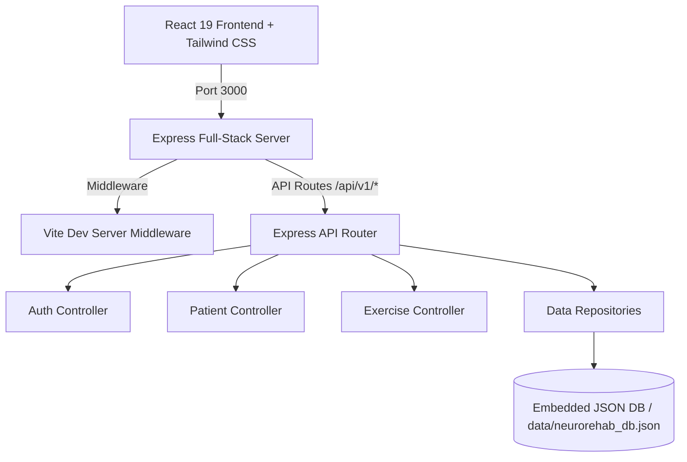

# NeuroRehab Connect - Tele-Rehabilitation Clinical Platform

> **Clinical Tele-Rehabilitation Portal & Biometric Exercise Tracking System**  
> Developed for Physiatrists, Neurologists, and Physical Therapists to prescribe, monitor, and adjust neuro-motor recovery programs with real-time biometric adherence feedback.

---

## 📋 Table of Contents
1. [Overview](#-overview)
2. [Summary of All Changes & Enhancements](#-summary-of-all-changes--enhancements)
   - [1. Vite Dev Server & Express Integration Fixes](#1-vite-dev-server--express-integration-fixes)
   - [2. Doctor Registration with Gender-Based Default Avatars](#2-doctor-registration-with-gender-based-default-avatars)
   - [3. Elimination of Fake/Placeholder Images](#3-elimination-of-fakeplaceholder-images)
   - [4. Doctor Profile Modal Custom Banner](#4-doctor-profile-modal-custom-banner)
   - [5. Removal of Quick Demo Authentication Bypass](#5-removal-of-quick-demo-authentication-bypass)
   - [6. Removal of Patient Mobile Simulator Component](#6-removal-of-patient-mobile-simulator-component)
3. [System Architecture](#-system-architecture)
4. [Active Project Pages & Views](#-active-project-pages--views)
5. [Asset Map & Media Attribution](#-asset-map--media-attribution)
6. [API Endpoints](#-api-endpoints)
7. [Installation & Getting Started](#-installation--getting-started)
8. [Database & Persistence Engine](#-database--persistence-engine)

---

## 🌟 Overview

**NeuroRehab Connect** is a full-stack clinical rehabilitation platform. It bridges the gap between in-clinic therapy and at-home patient recovery by allowing clinicians to:
- Formulate personalized physical therapy regimens (motor angle thresholds, repetitions, hold times).
- Monitor compliance, range-of-motion progress, and pain scores over time.
- Review exercise execution sessions and adjust prescriptions on the fly.
- Authenticate securely with role-based access control (Doctor & Patient roles).

---

## 🛠 Summary of All Changes & Enhancements

Here is a detailed breakdown of all updates, bug fixes, and feature additions implemented across the codebase:

### 1. Vite Dev Server & Express Integration Fixes
* **ESM Compatibility (`vite.config.ts`)**:
  - Fixed ES module warning/error where CommonJS `__dirname` was used in `vite.config.ts`.
  - Upgraded to modern Node.js ESM standard: `import.meta.dirname`.
* **Explicit Server Startup URLs (`server.ts`)**:
  - The application uses a unified architecture where Express serves both the backend REST API (`/api/v1/*`) and the Vite frontend middleware in development.
  - Updated console output on startup to clearly display the direct access link:
    ```
    👉 Local App URL: http://localhost:3000/
    ```
    (Prevented confusion regarding default Vite port 5173).

---

### 2. Doctor Registration with Gender-Based Default Avatars
* **Data Model & Backend Updates (`server/models/repositories.ts` & `authController.ts`)**:
  - Added `gender: 'male' | 'female' | 'other'` and `profilePic?: string` properties to the `IUser` schema and `UserRepository.create`.
  - Updated `/api/v1/auth/register-doctor` endpoint to automatically assign default profile pictures:
    - **Male Doctor**: Assigned `/doctor-male.png` (sourced from user-provided `resource/image copy 2.png`).
    - **Female/Other Doctor**: Assigned `/doctor-female.png` (sourced from user-provided `resource/image copy 3.png`).
  - Doctors can still change their avatar or upload a custom URL later in their profile settings.
* **Frontend UI Form (`src/components/DoctorAuthModal.tsx`)**:
  - Added an interactive gender selector (`Male`, `Female`, `Other`) with clear active states and icons in the registration tab.
  - Linked the selection to `ApiService.registerDoctor({ ..., gender })`.

---

### 3. Elimination of Fake/Placeholder Images
* **Zero External Placeholder Images**:
  - Removed all external Unsplash stock photo URLs for patients and doctor profile defaults.
  - Copied user's provided assets into the public web root:
    - `public/doctor-male.png` (from `resource/image copy 2.png`)
    - `public/doctor-female.png` (from `resource/image copy 3.png`)
    - `public/doctor-bg.png` (from `resource/image copy 4.png`)
    - `public/patient-default.png` (from `resource/image copy 5.png`)
* **Standardized Patient Avatars**:
  - Replaced random stock portraits in `PatientDetailView.tsx` and `DoctorDashboard.tsx` with `/patient-default.png`.
  - Added graceful fallback so that any patient without an avatar displays the designated `/patient-default.png`.

---

### 4. Doctor Profile Modal Custom Banner
* **Custom Background Asset (`src/components/DoctorProfileModal.tsx`)**:
  - Updated the modal cover banner image to use `/doctor-bg.png`.
  - Verified aspect ratio and responsive scaling for clinical header display.

---

### 5. Removal of Quick Demo Authentication Bypass
* **Cleaned Up Auth Flow (`src/components/DoctorAuthModal.tsx`)**:
  - Removed the hardcoded "Quick Demo" button and the sample credentials banner.
  - All clinicians now sign in using their real credentials or create a new account through the streamlined registration form.

---

### 6. Removal of Patient Mobile Simulator Component
* **Clean Codebase (`PatientMobileSimulator.tsx`)**:
  - Removed `src/components/PatientMobileSimulator.tsx` to keep the web application focused purely on the clinician portal and administrative management.
  - Cleaned up any residual references or imports across the project.

---

## 🏛 System Architecture



- **Frontend**: React 19, TypeScript, Lucide Icons, Tailwind CSS v4, Motion (Framer Motion).
- **Backend**: Express 4, TypeScript (executed with `tsx`), JWT auth, bcryptjs.
- **Embedded Database**: Local persistent JSON storage engine (`data/neurorehab_db.json`) with auto-seeding. Supports external MongoDB Atlas if configured in `.env`.

---

## 📱 Active Project Pages & Views

1. **Landing Page (`src/components/LandingPage.tsx`)**:
   - Clinical marketing page showcasing tele-rehabilitation features, adherence statistics, and security compliance.
   - Entry point for Clinician Authentication.
2. **Doctor Authentication Modal (`src/components/DoctorAuthModal.tsx`)**:
   - Secure Login & Registration with Gender selection and automatic profile photo assignment.
3. **Doctor Dashboard (`src/components/DoctorDashboard.tsx`)**:
   - Overview of active rehabilitation patients, adherence metrics, search, and status filters.
4. **Patient Detail View (`src/components/PatientDetailView.tsx`)**:
   - Detailed patient file showing range of motion progress charts, prescribed exercises, and session histories.
5. **New Patient Prescription Modal (`src/components/NewPatientPrescriptionModal.tsx`)**:
   - Modal for enrolling a new patient and prescribing physical therapy regimens.
6. **Doctor Profile Modal (`src/components/DoctorProfileModal.tsx`)**:
   - Profile management with custom banner (`/doctor-bg.png`), hospital affiliation, specialization, and avatar editing.
7. **System Architecture & Test Suites (`ArchitectureReport.tsx`, `TestVerificationSuite.tsx`)**:
   - Built-in audit components verifying system readiness and API health.

---

## 🎨 Asset Map & Media Attribution

| Asset Path | Sourced From | Description |
| :--- | :--- | :--- |
| `public/doctor-male.png` | `resource/image copy 2.png` | Default avatar for Male Doctors upon registration |
| `public/doctor-female.png` | `resource/image copy 3.png` | Default avatar for Female / Other Doctors upon registration |
| `public/doctor-bg.png` | `resource/image copy 4.png` | Header cover banner in Doctor Profile Modal |
| `public/patient-default.png` | `resource/image copy 5.png` | Standardized avatar for all rehabilitation patients |

---

## 🔌 API Endpoints

### Authentication (`/api/v1/auth`)
- `POST /register-doctor`: Register doctor with name, email, password, specialty, hospital, and **gender**.
- `POST /login`: Authenticate and receive JWT token.
- `GET /me`: Fetch authenticated doctor's profile.
- `PUT /profile`: Update profile info, specialty, or avatar.

### Clinical & Patients (`/api/v1/patients`)
- `GET /`: List all patients under current doctor.
- `POST /`: Enroll new patient and assign initial therapy prescription.
- `GET /:id`: Retrieve patient details, adherence logs, and exercise progress.
- `PUT /:id/prescription`: Update exercise regimens (sets, reps, angles).

### System & Health (`/api`)
- `GET /health`: Server health check, active DB engine, and uptime.

---

## 🚀 Installation & Getting Started

1. **Install Dependencies**:
   ```bash
   npm install
   ```

2. **Run Development Server**:
   ```bash
   npm run dev
   ```

3. **Access Application**:
   Open your browser to:
   ```
   http://localhost:3000/
   ```

---

## 💾 Database & Persistence Engine

The platform operates out-of-the-box using the embedded JSON data engine:
- Location: `data/neurorehab_db.json`
- Automatic atomic writes on state change.
- Seeded with sample clinical patients and realistic tele-rehabilitation logs.
- Can connect to MongoDB by providing `MONGODB_URI` in `.env`.
